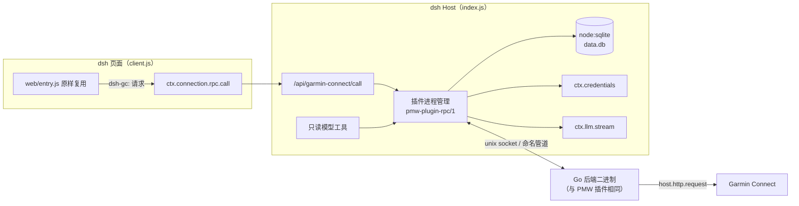

# Garmin 跑步数据 · DeepSeek Harness 插件

把 Garmin 跑步数据插件装进 [DeepSeek Harness](https://github.com/deepseek-ai/deepseek-harness)（dsh）客户端：左侧栏多出「Garmin 跑步」入口，功能和 PMW 工作台里的插件一致；对话里还能直接问跑步数据（「我这周跑了多少」「上个月和这个月比怎么样」「计划这周还剩什么」）。

由 DeepSeek Harness（dsh）协助完成。

## 能做什么

- **左侧栏「Garmin 跑步」**：
  - 跑步数据：记录、统计、体能、日历、计划、视频，详情页带地图（轨迹标分段配速）、图表、分段和 AI 分析；配速单位与心率区间可在设置里校准；
  - 比赛：比赛成绩（净计时 / 枪声成绩）、个人最好成绩、影像记忆；
  - 账号与同步：用 Garmin Connect 账号密码或个人 API Key（支持 MFA）登录，后端每 6 小时自动同步。
- **只读模型工具**：

  | 工具 | 用途 |
  |---|---|
  | `garmin_recent_activities` | 最近的运动记录，可按日期、室外 / 室内 / 力量过滤 |
  | `garmin_activity_detail` | 单次活动的详情摘要（分段、心率、训练效果、已有 AI 分析） |
  | `garmin_training_stats` | 按周 / 月 / 年汇总跑量 |
  | `garmin_training_calendar` | 一段日期里的训练安排和实际完成情况 |
  | `garmin_races` | 比赛成绩与个人最好成绩 |

- **AI 分析**：使用 dsh 当前的默认模型（设置 → 模型），也可以在插件配置里单独指定 `provider` / `model`。

## 安装

需要 DeepSeek Harness 0.2.x，自带 Node 24。

```bash
# 从 GitHub 安装（desktop 换成你用的 profile 名）
dsh plugin --profile desktop add "github:lizhao903/pmw-plugin-garmin_connect#path:/dsh"

# 本地开发：指向仓库里的 dsh/ 目录
dsh plugin --profile desktop add "link:/path/to/pmw-plugin-garmin_connect/dsh"
```

装好后重启 dsh（或在插件管理里把这个 bundle 关掉再打开），刷新页面。

首次启动会从本仓库同版本的 GitHub Release 下载 Go 后端二进制，并用 `SHA256SUMS` 校验；目前提供 darwin-arm64、linux-amd64 和 windows-amd64。仓库里如果已经有 `make build` 的产物（`bin/`），会直接用它。

## 配置

在 profile 的 `cordis.patch.yml` 里按 id 覆盖：

```yaml
- id: garmin-connect
  config:
    provider: newapi            # AI 分析用的模型，留空用 dsh 默认模型
    model: deepseek-v4-flash
    binary: ''                  # 指定 Go 二进制路径；留空自动查找或下载
    autoDownload: true
    tools: true                 # 是否注册只读跑步数据工具
```

## 数据放在哪

`$DSH_HOME/cache/garmin-connect/`（默认 `~/.dsh/cache/garmin-connect/`）：

- `data.db`：跑步记录、详情缓存、计划、日历、比赛、视频；和 PMW 插件的库结构相同，迁移记录表也相同，可以直接拷贝过来；
- `media/`：比赛影像；
- `bin/<版本>/`：下载的 Go 二进制；
- `logs/host.log`、`logs/plugin.log`：Host 半侧日志和 Go 后端日志。

Garmin 令牌存在 dsh 凭据存储里（记录 `garmin-connect/token`）；没有凭据服务时，存到 `secrets.json`（权限 0600）。账号密码不保存。

## 工作方式



- **Host 半侧（`index.js`）**：扮演 PMW 宿主，启动并驱动 Go 后端，实现它要用的宿主接口：
  - `host.store.*`：node:sqlite 存储，启动前执行包内迁移；
  - `host.secrets.*`：读写 Garmin 令牌；
  - `host.http.*`：出网请求和大文件的流式回传；
  - `host.agent.run`：AI 分析调用模型。
- **浏览器半侧（`client.js`）**：由 `scripts/build.mjs` 生成，把 `../web/entry.js` 嵌进 dsh 的模块工厂：
  - 请求改走 carrier-neutral RPC，所以桌面壳和 Web GUI 都能用；
  - 地图瓦片和比赛影像换成用 RPC 取回的 blob URL；
  - PMW 的 module 和设置槽位挂到 dsh 的左侧栏和主面板。

## 开发

```bash
make build      # 构建当前平台的 Go 后端（dsh 开发时直接用 bin/ 下的产物）
make dsh        # 重新生成 dsh/client.js、dsh/migrations、dsh/icon.svg，同步 package.json 版本
make dsh-check  # CI 用：派生文件不是最新就失败
```

`client.js`、`migrations/` 和 `icon.svg` 都是生成的，不要直接改。改前端就改 `../web/entry.ts`，改 dsh 适配层就改 `src/client.template.js`，然后执行 `make dsh`。用 `link:` 安装时，改完刷新页面即可；改了 `index.js` 要重启 dsh。

已知限制：

- 在 dsh 页面里查看比赛影像时，单个文件最大 200 MB，因为要整块读进页面；
- 开了两步验证（MFA）的 Garmin 账号请用「个人 API Key」登录（Garmin Connect 网页生成）；该模式只读，不能把活动编辑保存回 Garmin。

[](https://github.com/deepseek-ai/deepseek-harness)
